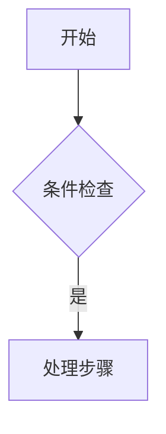
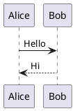

# Firefly 功能说明

> 本文整理自仓库中原有的演示内容（Markdown 教程 / 扩展语法 / 代码块 / Mermaid / PlantUML / KaTeX / MDX / 加密文章 / 布局系统 / Wiki Link 等）。整理日期：2026-11-23。演示文章、动态和示例项目已从内容目录中删除，功能说明保留于此，便于后续写作和配置时查阅。

---

## 一、内容系统

### 1.1 文章 Frontmatter

文章放在 `src/content/posts/`，支持 `.md` 与 `.mdx`，可用子目录组织，目录内的 `index.md` 也可以作为文章。

```yaml
---
title: 我的第一篇博客文章
published: 2023-09-09
description: 这是我新 Astro 博客的第一篇文章。
image: ./cover.jpg
tags: [前端, 开发]
category: 前端开发
draft: false
---
```

| 字段 | 说明 |
|---|---|
| `title` | 文章标题（必填） |
| `published` | 发布日期（必填） |
| `updated` | 更新日期；未设置时默认使用发布日期 |
| `pinned` | 是否置顶在文章列表顶部 |
| `description` | 文章简介，显示在首页列表 |
| `image` | 封面图。支持网络图片（`http(s)://`）、`public` 目录（`/` 开头）、相对 Markdown 文件的路径；`api` 可启用随机封面图 |
| `tags` | 标签数组 |
| `category` | 分类 |
| `lang` | 文章语言代码（如 `zh-CN`），仅当与站点默认语言不同时设置 |
| `licenseName` / `licenseUrl` | 文章内容的许可证名称 / 链接 |
| `author` | 文章作者 |
| `sourceLink` | 内容来源或参考链接 |
| `draft` | 草稿开关；为 `true` 时生产环境不展示 |
| `comment` | 是否启用本文评论，默认 `true` |
| `slug` | 自定义 URL 路径；不设置时使用文件名 |
| `password` / `passwordHint` | 文章密码 / 密码提示，启用加密文章 |
| `series` / `seriesOrder` | 所属系列名称 / 系列内顺序，用于系列文章导航 |
| `prevTitle` / `prevSlug` / `nextTitle` / `nextSlug` | 内部使用，构建时自动填充 |

### 1.2 URL（Slug）规则

- 默认使用文件名作为 URL：`src/content/posts/my-first-blog-post.md` → `/posts/my-first-blog-post`
- 设置 `slug: hello-world` 后 → `/posts/hello-world`
- `slug` 会自动转为小写；一旦发布不建议修改，以免破坏 SEO 和已有链接
- 多个文章使用相同 `slug` 时，后面的会覆盖前面的
- 子目录文章可写成 `slug: guide/firefly-layout-system`，保留目录层级
- 建议使用英文、数字和连字符，保持简短且有描述性

### 1.3 草稿、置顶、系列与评论

- **草稿**：`draft: true` 的文章不会对普通读者展示；发布时改为 `false`
- **置顶**：`pinned: true` 让文章固定在列表顶部
- **系列**：`series` + `seriesOrder` 把文章归入同一系列，文章页显示系列导航
- **评论**：`comment: false` 单独关闭某篇文章的评论
- **版权信息**：`licenseName`、`licenseUrl`、`author`、`sourceLink` 会在文章底部生成版权/来源区块

### 1.4 文章加密

在 Frontmatter 中设置 `password` 即可启用密码保护：

```yaml
password: "123456"
passwordHint: "示例文章密码123456"
```

- **构建时加密**：正文在构建阶段使用 AES-256-GCM 加密，页面源码中不含明文
- **客户端解密**：访客输入正确密码后，浏览器通过 Web Crypto API 在本地解密
- **会话缓存**：密码缓存在 `sessionStorage`，同一会话内刷新页面无需重复输入
- **关闭即失效**：关闭浏览器后缓存清除，再次访问需要重新输入
- `passwordHint` 显示在密码输入框上方，帮助访客回忆密码

### 1.5 Markdown 与 MDX

两种文章格式都支持，可混合使用：

| 特性 | Markdown (`.md`) | MDX (`.mdx`) |
|---|---|---|
| 基础语法 | 支持（CommonMark/GFM） | 支持 |
| HTML 标签 | 支持 | 支持（按 JSX 解析） |
| 导入组件 | 不支持 | 支持 `import` |
| JS 表达式 | 不支持 | 支持 |
| 样式定制 | 有限 | 灵活 |

没有复杂交互需求时推荐普通 Markdown；需要嵌入组件或 JSX 时再用 MDX。

---

## 二、Markdown 扩展语法

### 2.1 基础语法

支持 CommonMark 与 GitHub Flavored Markdown，包括：段落与换行、标题（Setext / ATX）、引用、无序/有序列表与嵌套、围栏代码块、分割线、表格、链接（行内/引用式）、强调、行内代码、图片（行内/引用式）、删除线、自动链接、反斜杠转义、内联 HTML。

### 2.2 提醒框（Admonitions）

基于 `rehype-callouts`，支持 4 种风格主题，在 `src/config/siteConfig.ts` 中配置（修改后需重启开发服务器）：

```ts
rehypeCallouts: {
  // "github" | "obsidian" | "vitepress" | "docusaurus"
  theme: "github",
}
```

- **GitHub**：`NOTE`、`TIP`、`IMPORTANT`、`WARNING`、`CAUTION`，支持自定义标题
- **Obsidian**：类型最丰富，含 `NOTE`、`ABSTRACT`/`SUMMARY`/`TLDR`、`INFO`、`TODO`、`TIP`/`HINT`、`IMPORTANT`、`SUCCESS`/`CHECK`/`DONE`、`QUESTION`/`HELP`/`FAQ`、`WARNING`/`CAUTION`/`ATTENTION`、`FAILURE`/`FAIL`/`MISSING`、`DANGER`/`ERROR`/`BUG`、`EXAMPLE`、`QUOTE`/`CITE`，支持自定义标题
- **VitePress**：`NOTE`、`TIP`、`IMPORTANT`、`WARNING`、`CAUTION`，支持自定义标题
- **Docusaurus**：`:::note`、`:::tip`、`:::info`、`:::warning`、`:::danger`，支持 `:::tip[自定义标题]`

GitHub 风格示例：

```markdown
> [!NOTE] NOTE
> 突出显示用户应该考虑的信息。

> [!TIP] 自定义标题
> 可选信息，帮助用户更成功。
```

### 2.3 GitHub 仓库卡片

```markdown
::github{repo="CuteLeaf/Firefly"}
```

渲染为动态卡片，页面加载时从 GitHub API 获取仓库信息（星标、描述、语言等）。

### 2.4 剧透

```markdown
内容 :spoiler[被隐藏了 **哈哈**]！
```

隐藏文本，点击后显示；内部仍支持 Markdown 语法。

### 2.5 图片画廊网格

用 `[grid]` / `[/grid]` 包裹多张图片，自动生成响应式并排网格（最多 4 张）：

```markdown
[grid]


[/grid]
```

- 同一排内高度/比例不一致的图片会以 `object-cover` 居中裁切，撑满并保证边框对齐
- 图注（alt）始终在同一水平基线上
- 被裁切的图片可点击通过灯箱查看完整图片，建议同排尽量使用比例一致的图片

### 2.6 Wiki Link（Obsidian 风格内部链接）

在 Markdown / MDX 中使用 `[[...]]` 链接到其他文章：

```markdown
[[firefly]]                 <!-- 单独成段：渲染为文章卡片 -->
请参阅 [[firefly]]。         <!-- 正文中间：渲染为普通链接 -->
[[firefly|主题介绍]]         <!-- 自定义显示文字 -->
[[code-examples#语法高亮]]   <!-- 链接到指定标题 -->
[[#本页目标]]                <!-- 链接到当前页标题 -->
```

- **单独成段**时自动读取目标文章的标题、描述、发布时间、分类、标签和封面，渲染为链接卡片
- **正文中间**时渲染为普通链接，链接文字自动使用文章标题
- `|` 后的别名会替换显示文字；若别名只是重复链接目标（如 `[[guide/index|index]]`），会被忽略
- 链接目标支持三种写法（按匹配顺序）：
  1. Frontmatter `slug`：`[[firefly-wiki-link]]`（Obsidian 不支持）
  2. 相对仓库根目录的文件路径：`[[guide/firefly-layout-system]]`（推荐，需在 Obsidian 中把内部链接类型设为“基于仓库根目录的绝对路径”）
  3. 仓库内唯一的裸文件名：`[[firefly-layout-system]]`（Obsidian 默认即可；重名时失效并给出构建提示）
- 将 `src/content/posts` 作为 Obsidian vault 打开时，文件路径写法与 Firefly 的解析路径完全一致
- 标题锚点使用与页面标题相同的 slug 规则（中文、空格、大小写按实际生成的 ID 处理）
- 暂不支持附件嵌入：`![[image.png]]` 会按原文显示；行内代码和代码块中的 `[[...]]` 不会被转换

---

## 三、图表与数学公式

### 3.1 Mermaid

````markdown

````

- 由 **Merman** 在 Astro 构建阶段渲染为**静态 SVG**，无需在浏览器加载 Mermaid 运行时
- 同时生成亮色与深色两套主题，随站点主题自动切换
- 支持：流程图、时序图、ER 图、类图、状态图、XY 图、饼图、甘特图、思维导图、时间线、用户旅程图、Git 图、看板、Sankey 图等
- 主题配置：`src/config/mermaidConfig.ts`
  - `lightTheme`：`editor-light` / `gruvbox-light` / `ayu-light`
  - `darkTheme`：`editor-dark` / `one-dark` / `gruvbox-dark` / `ayu-dark`
- 可在 [Merman Playground](http://frankorz.com/merman/) 调试语法

### 3.2 PlantUML

````markdown

````

- 构建阶段编码 PlantUML 源码并生成服务器 SVG 地址，页面端按亮/暗主题切换图源
- 支持图表缩放、拖拽和全屏查看
- 可绘制活动图、状态图、用例图、组件图、部署图、ER 图、时序图、C4 风格容器图等
- 配置：`src/config/plantumlConfig.ts`
  - `enable`：关闭后 `plantuml` 代码块退化为普通代码高亮
  - `server`：PlantUML 服务器地址，默认官方公共服务器；敏感内容建议自建
  - `lightTheme` / `darkTheme`：注入 `!theme <name>`，默认暗色使用 `cyborg`
- 依赖外部 PlantUML 服务器，图表源码会发送到该服务器

### 3.3 KaTeX 数学公式

- 行内公式：`$e^{i\pi} + 1 = 0$`
- 块级公式：`$$ ... $$`，居中显示

```markdown
$$
x = \frac{-b \pm \sqrt{b^2 - 4ac}}{2a}
$$
```

- 支持矩阵、极限、求和、麦克斯韦方程组、对齐环境等复杂写法
- 通过 mhchem 支持化学方程式：`\ce{CH4 + 2O2 -> CO2 + 2H2O}`
- 符号参考：[KaTeX Supported Functions](https://katex.org/docs/supported.html)

---

## 四、代码块（Expressive Code）

基于 [Expressive Code](https://expressive-code.com/)，支持丰富的代码展示能力。

### 4.1 语法高亮与框架

- 常规语法高亮；`ansi` 代码块可渲染 ANSI 转义序列（含 8-bit / 24-bit 颜色、粗体、斜体、下划线等）
- 编辑器/终端框架自动识别，可用 `title="文件名"` 添加标题
- 用 `frame="none"` 关闭框架，`frame="code"` 强制使用编辑器框架

````markdown
```js title="my-test-file.js"
console.log("标题属性示例")
```

```sh frame="none"
echo "没有框架"
```
````

### 4.2 行标记与文本标记

- 标记整行/行范围：```` ```js {1, 4, 7-8} ````
- 选择标记类型：`{6}`（中性 mark）、`ins={3-4}`（插入）、`del={2}`（删除）
- 给行标记加标签：```` ```jsx {"1":5} del={"2":7-8} ins={"3":10-12} ````
- 支持长标签写法：`{"1. Provide the value prop here:":5-6}`
- 使用 diff 语法自动标记 `+` / `-` 行；可与语法高亮组合：```` ```diff lang="js" ````
- 标记行内指定文本：```` ```js "given text" ````；支持正则：```` ```ts /ye[sp]/ ````
- 内联标记类型：```` ```js "return true;" ins="inserted" del="deleted" ````

### 4.3 换行、折叠与行号

- 自动换行：```` ```js wrap ````；关闭：`wrap=false`；缩进：`preserveIndent` / `preserveIndent=false`
- 可折叠部分：```` ```js collapse={1-5, 12-14} ````
- 行号：```` ```js showLineNumbers ````；关闭 `showLineNumbers=false`；起始行号 `showLineNumbers startLineNumber=5`

### 4.4 代码组（Tab 代码块）

由 `rehype-code-group` 提供，语法与 VitePress 代码组一致：

`````markdown
::: code-group labels=[code.js, code.py, code.html]

```js
export function greet(name) {
  return `Hello, ${name}!`;
}
```

```py
def greet(name):
    return f"Hello, {name}!"
```

:::
`````

- `labels=[...]` 按顺序对应组内代码块，英文逗号分隔；`:::` 与 `code-group` 之间的空格不能省略
- 标签支持 emoji 短代码，如 `labels=[:package: npm, :package: pnpm]`
- 组内仍是普通 Expressive Code 代码块，标题、行号、行标记、折叠、终端框架等均可使用
- 标签页内可放任意内容（段落、列表、图片等），不限于代码块
- 标签栏在构建期生成，默认展开第一项；支持鼠标点击与键盘 `←` / `→` / `Home` / `End` 切换

> **嵌套限制**：`::: code-group` 不能嵌套在 `::: tip` 等 Docusaurus 提醒框内（micromark-directive 要求父子容器冒号数不同，否则整块失效）。这种场景改用 MDX 的 `TabGroup` 组件。

### 4.5 MDX TabGroup

````mdx
import { TabGroup } from "@/components/firefly-mdx";

:::tip
<TabGroup labels={["test.js", "test.py"]} client:load>
  ```js
  console.log(1)
  ```

  ```py
  print("hello world")
  ```
</TabGroup>
:::
````

- `labels` 数组按顺序对应各代码块
- 用 `client:load` 激活标签切换
- 不受 `:::` 容器嵌套限制，提醒框内外都能正常使用

---

## 五、MDX 专属 UI 组件

从统一入口导入（一个 import 引入多个组件）：

```mdx
import { Badge, StepItem, Steps, TabGroup, Timeline, TimelineItem } from "@components/firefly-mdx";
```

| 组件 | 用途 | 主要属性 |
|---|---|---|
| `TabGroup` | 可切换标签页 | `labels`（数组）、`client:load` |
| `Timeline` / `TimelineItem` | 时间线 | `date`、`title`、`type`（default/tip/note/important/warning/caution）、`icon`；正文支持 Markdown |
| `Steps` / `StepItem` | 编号步骤条，编号自动生成 | `title`、`type`、`icon`；正文支持 Markdown |
| `Badge` | 内联彩色小徽章 | `type`（default/tip/note/important/warning/caution） |

可用内置图标名：`star`、`rocket`、`git`、`flag`、`book`、`heart`、`zap`、`bug`、`tag`、`calendar`、`code`、`edit`。

`TimelineItem` / `StepItem` 设置 `icon` 时显示图标而非默认圆点/数字。

---

## 六、媒体嵌入

### 6.1 视频

直接把平台提供的 `<iframe>` 嵌入代码粘贴进 Markdown 即可：

- YouTube：`https://www.youtube.com/embed/<video-id>`
- Bilibili：`//player.bilibili.com/player.html?bvid=<BV号>`

```html
<iframe width="100%" height="468" src="https://www.youtube.com/embed/xxxx" title="YouTube video player" frameborder="0" allowfullscreen></iframe>
```

### 6.2 图片

- 支持 Markdown 图片、引用式图片、内联 HTML ``
- 图片可点击打开灯箱（PhotoSwipe/Fancybox）查看大图
- 图片网格中被裁切的图片尤其需要灯箱查看完整内容

---

## 七、布局系统

布局由两个维度组合：**侧边栏布局**与**文章列表布局**。

### 7.1 侧边栏

配置：`src/config/sidebarConfig.ts`

```ts
export const sidebarLayoutConfig: SidebarLayoutConfig = {
  enable: true,
  position: "left", // "left" | "right" | "both"
};
```

- **单侧边栏**：`left` 或 `right`，阅读区更宽敞、页面更简约；适合传统博客、强调导航/分类/个人资料的站点
- **双侧边栏**：`both`，主内容居中，左右展示更多辅助信息；适合宽屏、信息密集型技术博客
- 某一侧在当前页型下没有可见组件时会**自动收起**，把空间让给内容栏
- 文章详情页显示哪几侧，由各组件的 `showOnPostPage` / `hideOnNonPostPage` 决定；`position: "both"` 时给两侧组件配好 `showOnPostPage` 即可在文章页同时显示双侧边栏

### 7.2 文章列表布局

配置：`src/config/siteConfig.ts` 的 `postListLayout`

```ts
postListLayout: {
  defaultMode: "list",    // "list" | "grid"
  coverPosition: "right", // "right" | "left"，仅列表模式
  grid: {
    masonry: true,        // 瀑布流
    columnWidth: 320,     // 卡片最小宽度(px)，自动计算列数
  },
}
```

- **列表模式**：单列纵向排列，可显示封面和更多摘要，适合深度阅读；封面默认在右，可改到左侧。封面改到左侧后，标题前的主题色竖线会自动隐藏
- **网格模式**：自适应列数，信息密度高；封面固定在卡片顶部
- **瀑布流（Masonry）**：自动把卡片放到最短的列，消除高度不一致造成的垂直空白；列数仍由 `columnWidth` 与容器宽度决定，可通过 `grid.masonry` 开关
- 常见组合（单侧+列表、单侧+网格、双侧+列表、双侧+网格）都支持，按内容类型选择

### 7.3 响应式行为

- 网格列数随容器宽度自动减少
- 屏幕宽度 **< 380px** 时，列表模式自动切换为网格模式，保证卡片可读性
- 屏幕宽度 **< 1280px** 时，双侧边栏按 `tabletSidebar` 配置回退为单侧边栏，其中一个侧边栏隐藏，文章目录切换为浮动目录导航

---

## 八、站点整体能力

以下能力来自主题 README / 项目介绍与配置文件：

### 8.1 核心

- **Astro + Tailwind CSS**：静态站点生成、快速加载、SEO 友好
- **Svelte 5 交互组件**：搜索、设置面板、分页、归档等
- **Swup 页面过渡**：SPA 式无刷新切换与过渡动画
- **响应式设计**：适配桌面、平板和移动端
- **多语言 i18n**：简体中文、繁体中文、英文、日文、俄文、韩文
- **全文搜索**：基于 Pagefind 的客户端搜索，构建时生成索引
- **TypeScript**：完整类型检查（`pnpm type-check`）

### 8.2 外观与个性化

- **主题色**：`siteConfig.themeColor.hue` 做 0–360° 色相调节，全站配色由该色相统一派生
- **亮暗模式**：`light` / `dark` / `system` 三种，支持运行时切换
- **壁纸模式**：横幅壁纸、全屏壁纸、全屏透明壁纸、纯色背景（`backgroundWallpaper`）
- **导航栏自定义**：Logo（Astro 图标 / 本地图片 / 网络图片）、标题、菜单对齐、跟随主题色、固定方式（static/fixed/dynamic）
- **页脚配置**：`FooterConfig.html` 注入任意 HTML
- **字体管理**：`fontConfig.ts` 自定义字体与字体选择器
- **文章卡片**：可开关边框/阴影、卡片风格跟随主题色
- **设置面板**：`displaySettingsConfig.ts` 控制主题色、布局、卡片、壁纸、特效等运行时开关（默认关闭以减小体积，可用 `PUBLIC_DISPLAY_SETTINGS=true` 开启）

### 8.3 内容与功能模块

- **内容集合**：`posts`（文章）、`dynamic`（动态/微语）、`projects`（项目展示）、`spec`（关于/友链/留言板等特殊页）
- **动态**：`src/content/dynamic/*.md`，支持 `pinned`、`location`，可用 `pnpm new-d <内容>` 创建；支持对接 Memos 实时获取动态
- **项目展示**：`src/content/projects/`，Frontmatter 支持 `order`、`status`（planning/developing/published/archived）、`link` 外链按钮；列表页支持状态筛选与搜索
- **评论系统**：`commentConfig.ts`（如 Giscus、Twikoo、Waline、Artalk 等）
- **统计分析**：`analyticsConfig.ts`（如 Google Analytics、Umami 等）
- **音乐播放器**：`musicConfig.ts`
- **公告**：`announcementConfig.ts`
- **动画特效**：`effectsConfig.ts`（樱花等）
- **看板娘**：`pioConfig.ts`（Live2D / Spine，可裁剪未使用资源）
- **相册 / 书签导航 / 友链 / 打赏 / Bangumi / VNDB / MAL / Bilibili 追番**：对应各自配置文件
- **文章加密、系列、置顶、草稿、许可证**：见第一章

### 8.4 构建与部署

- 构建流水线：LQIP 生成 → VNDB 封面下载 → `astro build` → 看板娘资源裁剪 → 字体子集化 → 内联脚本压缩 → Pagefind 索引
- 部署目标：Vercel（默认）、Cloudflare Workers，输出静态文件到 `dist/`

---

## 九、配置与命令速查

### 9.1 配置文件（`src/config/`）

| 文件 | 作用 |
|---|---|
| `siteConfig.ts` | 站点标题、描述、主题色、布局、导航、分页等核心配置 |
| `sidebarConfig.ts` | 侧边栏位置（left/right/both）与组件排序 |
| `backgroundWallpaper.ts` | 壁纸模式与参数 |
| `displaySettingsConfig.ts` | 设置面板及各开关 |
| `navBarConfig.ts` | 导航栏菜单 |
| `profileConfig.ts` | 侧边栏个人资料 |
| `fontConfig.ts` | 字体 |
| `commentConfig.ts` | 评论系统 |
| `analyticsConfig.ts` | 统计分析 |
| `announcementConfig.ts` | 公告 |
| `musicConfig.ts` | 音乐播放器 |
| `effectsConfig.ts` | 页面特效 |
| `pioConfig.ts` | 看板娘 |
| `mermaidConfig.ts` | Mermaid 亮暗主题 |
| `plantumlConfig.ts` | PlantUML 服务器与主题 |
| `expressiveCodeConfig.ts` | 代码块亮暗主题 |
| `galleryConfig.ts` / `friendsConfig.ts` / `sponsorConfig.ts` / `booknavConfig.ts` | 相册 / 友链 / 打赏 / 书签导航 |
| `FooterConfig.html` | 页脚 HTML |

### 9.2 常用命令

| 命令 | 作用 |
|---|---|
| `pnpm dev` | 本地开发服务器（`localhost:4321`） |
| `pnpm build` | 生产构建到 `dist/` |
| `pnpm preview` | 预览生产构建 |
| `pnpm check` | Astro 类型/错误检查 |
| `pnpm type-check` | `tsc` 类型检查 |
| `pnpm lint` / `pnpm format` | Biome 检查 / 格式化 |
| `pnpm new-post <filename>` | 新建文章 |
| `pnpm new-dynamic <content>`（`pnpm new-d`） | 新建动态 |
| `pnpm lqips` | 重新生成图片 LQIP |

---

## 十、清理演示内容后的站点状态

- `src/content/posts/`、`src/content/dynamic/`、`src/content/projects/` 均已清空（保留目录与 `.gitkeep`）；首页文章列表、归档、分类、标签、系列、搜索索引以及动态/项目列表均为空
- 特殊页（`src/content/spec/`：关于、友链、留言板）未删除
- 新建内容：文章用 `pnpm new-post <filename>`；动态用 `pnpm new-d <content>`；项目在 `src/content/projects/` 下新建 `.md` / `.mdx`
- 演示内容用到的图片资源已一并删除，`lqips.json` 中的失效记录已清理；如需要可从 Git 历史恢复
